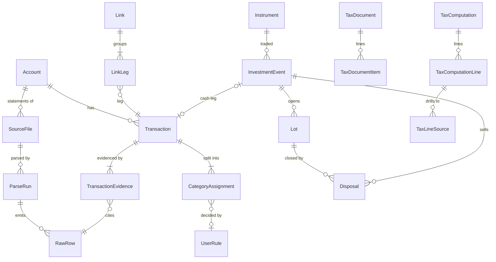

# Phase 0 — Plan

**Status:** proposal, waiting for your go-ahead.
**Context date:** 12 Oct 2026. The current year is **tax year 2026-27** (1 Apr 2026 – 31 Mar 2027),
the first year under the Income-tax Act, 2025. Years in scope: FY 2022-23, 2023-24, 2024-25,
2025-26 (all under the 1961 Act) and tax year 2026-27 (2025 Act).

Contents: [1 Deviations](#1-proposed-deviations-from-the-spec) · [2 Architecture](#2-architecture) ·
[3 Repo](#3-repo-structure) · [4 Data model](#4-data-model) · [5 Parsers](#5-parser-plugin-interface) ·
[6 Rule files](#6-rule-files) · [7 Linking & categorisation](#7-linking-and-categorisation-design-notes) ·
[8 Optional LLM](#8-optional-llm-assist) · [9 Phases](#9-phase-plan) · [10 Risks](#10-risks) ·
[11 Sample files](#11-how-to-redact-sample-files) · [12 Questions](#12-open-questions-and-assumptions)

---

## 1. Proposed deviations from the spec

Each of these is a change I would make, with the reason. Say no to any and I'll follow the spec as written.

| # | Spec | Proposal | Why |
|---|------|----------|-----|
| D1 | Dedupe on a key of (account, date, amount, normalised narration, running balance) | Match **within (account, date, amount) groups**, using balance, references and narration as *evidence*, one-to-one (§4.3) | The same bank's PDF and CSV exports word the same narration differently (wrapping, truncation), and card statements have no running balance. A hash *including* narration double-counts across formats; a hash *excluding* it merges two genuine ₹500 UPI payments on the same day. Group matching handles both. |
| D2 | A transaction always has exactly one tax bucket | Exactly one tax bucket **per split**; most transactions have one split | A salary credit is gross minus deductions; an EMI is principal plus interest; a US dividend is gross minus withholding. |
| D3 | (implicit) salary from statements | Form 16 / payslips are the **source** for salary; bank credits are **reconciliation evidence** | Banks see only net pay. The acceptance test "salary reconciles with Form 16 within ₹1, or the gap is explained" runs in that direction. |
| D4 | (implicit) FD interest from bank credits | Cumulative FD/RD interest comes from **interest certificates / AIS (accrual)** | A cumulative FD credits nothing until maturity, but TDS is deducted on accrual every year. See TQ-009. |
| D5 | `pdfplumber` / `camelot` | `pdfplumber` first; add `camelot` only if a layout needs it | camelot pulls in Ghostscript/OpenCV. Most bank PDFs are text-layer tables pdfplumber handles. |
| D6 | Hungarian or greedy assignment | **Greedy by score + ambiguity check** (if the runner-up is within 0.1, the pair goes to Review) | Candidate sets inside a ±3-business-day window are tiny; greedy is easier to explain in the Review Queue and avoids scipy. |
| D7 | Minimum tables | Added `ParseRun`, `TransactionEvidence`, `InvestmentEvent`, `ManualInput`, `ColumnMappingTemplate`, `FxRate`, `LlmCallLog`, `AppSetting` | Parser history per file, many-sources-per-transaction audit, trades/corporate actions as the input that lots are derived from, and the logs the non-negotiables require. |
| D8 | Account types | Added `rd`, `ppf`, `loan`, `other` | PPF (80C, exempt interest) and home loans (24(b), principal in 80C) need a home. |
| D9 | — | New document type: **filed ITR** (the JSON you download from the portal) | It is the only reliable source of brought-forward losses, and it lets the app check prior years against what you actually filed. |
| D10 | — | Hardening: fonts bundled locally (no Google Fonts request), Next.js telemetry disabled in every script, engine rejects non-loopback `Host` headers | "No telemetry" includes the framework's own. The Host check stops a malicious web page from reaching the engine via DNS rebinding. |
| D11 | `make dev` or `docker compose up` | `make dev` primary (uv + pnpm); compose file added in Phase 8 mainly for OCR deps | Native is faster to iterate; Docker is mostly useful for Tesseract/OCRmyPDF. |

---

## 2. Architecture

```
 Browser ──► Next.js  127.0.0.1:3000   (UI only, holds no data)
                │  /api/*  (same-origin rewrite, no CORS)
                ▼
            FastAPI  127.0.0.1:8000  ──► SQLite   data/taxcopilot.sqlite3   (WAL, FKs on)
                │                    ──► Files    data/uploads/<sha256>.<ext>  (originals, kept)
                └── reads ──► rules/FY*.yaml, rules/taxonomy.yaml, rules/manual_inputs.yaml
```

Backend pipeline:

```
upload ─► sniff format ─► (password? unlock in memory) ─► detect (every parser) ─► choose parser
       ─► parse (pure) ─► validate ─► confirm account ─► dedupe + persist ─► tie-out ─► coverage
                                                                      │
                     link (Phase 2) ◄─────────────────────────────────┘
                     categorise (Phase 3) ─► tax inputs ─► computation lines (Phases 4–6) ─► plan (7)
```

Every stage is deterministic. Re-running any stage over the same inputs gives the same output, which
is what makes "re-apply my corrections retroactively" and "change a slab and recompute" safe.

---

## 3. Repo structure

```
Tax-Copilot/
├── Makefile                  setup · dev · test · lint · fmt · build · db-upgrade · db-revision
├── scripts/dev.sh            migrates, then runs engine + UI on 127.0.0.1
├── TAX_QUESTIONS.md          every tax edge case: scenario, best reading, source, status
├── docs/PHASE0_PLAN.md       this document
├── rules/                    statutory rules as data (format in rules/README.md)
│   ├── README.md
│   ├── FY2022-23.yaml … FY2026-27.yaml      (Phase 4)
│   ├── taxonomy.yaml         life categories + tax-bucket leaf codes (Phase 3)
│   └── manual_inputs.yaml    declared manual-input keys and shapes (Phase 4)
├── backend/
│   ├── pyproject.toml        uv-managed; ruff + mypy --strict
│   ├── alembic/              migrations (0001 = initial schema)
│   ├── src/taxcopilot/
│   │   ├── main.py           FastAPI app factory, loopback Host guard
│   │   ├── config.py         data dir, rules dir, host/port, LLM flag
│   │   ├── db.py             engine/session; SQLite pragmas
│   │   ├── db_types.py       DecimalText (exact, rejects floats), utcnow
│   │   ├── models/           the schema (§4)
│   │   ├── api/              routers under /api
│   │   ├── ingestion/        interface.py, registry.py; parsers/<institution>_<kind>.py
│   │   ├── linking/          candidates, scoring, assignment, link rules
│   │   ├── categorise/       pipeline, built-in dictionaries, user-rule engine
│   │   ├── tax/              rule loader, inputs collector, computation graph, CG engine, cross-checks
│   │   └── planning/         projection, advance tax, harvesting, regime what-ifs
│   └── tests/
│       ├── fixtures/<parser id>/   anonymised files + expected.yaml
│       └── test_*.py
└── frontend/                 Next.js App Router + TS + Tailwind; shadcn/ui conventions
    └── src/{app,components,lib}
```

`/data` and `/uploads` are git-ignored, and so are `*.pdf *.xls *.xlsx *.csv` everywhere except
`backend/tests/fixtures/`. That safety net stops a real statement from being committed by accident.

---

## 4. Data model

The models are in `backend/src/taxcopilot/models/`; migration `0001` creates them. A test fails if the
models and migrations ever drift apart.



### 4.1 Conventions

- **Money** is an integer count of minor units: paise for INR, cents for USD, in `BigInteger`
  columns. Column names say which: `*_paise` is always INR; `*_minor` is in the row's `currency`.
- **Non-money decimals** (quantities, NAV, prices, FX rates, 31-Jan-2018 FMV) use `DecimalText`.
  It stores the exact string, round-trips to `Decimal`, and **raises on a float**. (SQLite has no
  decimal type; SQLAlchemy's `Numeric` silently goes through REAL.)
- **Sign:** from the account holder's side. Credit is `+`, debit is `−`. On a credit card a
  purchase is `−` and a payment is `+`.
- **Dates:** `txn_date` decides which FY a cash item falls in; the transfer (trade) date decides it
  for capital gains (see TQ-025). Timestamps are naive UTC.
- **Enums** are stored as strings with no CHECK constraint, so adding a value never forces a SQLite
  table rebuild.

### 4.2 Provenance: every number traces back to text

```
TaxComputationLine ─► TaxLineSource ─► Transaction | CategoryAssignment | Disposal | TaxDocumentItem | ManualInput
                                             │
                                  TransactionEvidence (1..n)
                                             │
                                          RawRow  (page, row, cells, bbox, raw text)
                                             │
                                        SourceFile ─► data/uploads/<sha256>  (the original file)
```

`RawRow` is append-only. Re-parsing with a newer parser version adds a `ParseRun` and new raw rows;
old ones stay for audit. `bbox` lets the UI highlight the exact line on the PDF page.

### 4.3 Idempotent ingestion (dedupe)

1. **Same file twice:** `SourceFile.sha256` is unique, so the upload returns the existing file.
2. **Overlapping or re-exported statements:** for each incoming cash row of account *A*, take the
   existing transactions in the group (*A*, `txn_date`, `amount_minor`). Match one-to-one, strongest
   evidence first:
   1. equal running balance;
   2. equal reference (UTR / UPI ref / IMPS ref / cheque no.);
   3. narration similarity ≥ threshold *and* same position within the day.

   A match adds a `TransactionEvidence` row and no new transaction. An unmatched row becomes a new
   transaction. A match whose balance or reference *contradicts* the existing row is not merged; it
   goes to Review as a conflict.
3. **Guard rail:** `UNIQUE(account_id, dedupe_key, dedupe_ordinal)`, where `dedupe_key = hash(date,
   amount)` and the ordinal is the next free slot. A bug elsewhere cannot insert the same row twice.

Acceptance test: upload the same statement twice, and the same period as PDF and as CSV → zero
duplicates, and every transaction shows both files as evidence.

### 4.4 Tie-out and coverage

- **Per file:** `opening + Σcredits − Σdebits = closing`, exact to the paisa, plus the file's stated
  totals and counts where it prints them.
- **Per row:** `previous balance + amount = this balance`. The first broken row is reported (it
  usually means a wrapped line was mis-parsed or a row was dropped).
- **Across files, per account:** the closing balance of file *n* must equal the opening of file
  *n+1*, and periods must be contiguous. Gaps show up as messages like *"No statement for ICICI
  between 14 Feb and 3 Mar 2025"*, and on the per-account coverage calendar.
- **Credit cards:** `previous due − payments + purchases + charges = total due`.

### 4.5 Links

- A `Link` has 2+ `LinkLeg`s with roles (`source/destination/fee/tax/original/counter`). A leg can
  carry `allocated_minor` for one-to-many, e.g. one bank debit funding three MF purchases.
- **Invariant:** a transaction is in at most one *confirmed* link, unless its legs' allocations sum
  to no more than its amount.
- **Rejected links are kept**, so the matcher never proposes the same pair again.
- `score_breakdown` stores why: date gap, amount delta, shared UTR, tokens found. The Review Queue
  shows it.

### 4.6 Category assignments

- The current assignments (`superseded_at IS NULL`) of a transaction sum to its amount. Each split
  has exactly one `tax_bucket` and an optional leaf `tax_code` from `rules/taxonomy.yaml`.
- `method` + `confidence` + (`user_rule_id` | `builtin_rule_id` | `llm_call_id`) + `explanation` are
  stored on every assignment. A correction **supersedes** the old assignment; it never overwrites.
- A confirmed transfer link sets `TRANSFER` structurally. User rules outrank everything except a
  manual edit.

### 4.7 Investments

- `InvestmentEvent` holds trades and corporate actions as the files report them (buy, sell, bonus,
  split, merger, buyback, RSU vest, ESPP, switch, off-market transfer). Each one points to its raw
  row and optionally to its cash leg in the ledger.
- `Lot` and `Disposal` are **derived** by the capital-gains engine (FIFO per account + instrument).
  They are stored for drill-down and rebuilt whenever events or rules change. Each `Disposal`
  records `rule_bucket` (e.g. `cg.equity_112a.post_2024_07_23`), the FMV used for grandfathering,
  and FX details.
- MF tax class (equity-oriented / specified MF u/s 50AA / other) is **derived per FY** from scheme
  facts, because the definition itself changed (TQ-008). Only a user override is stored.

### 4.8 Computations

- A `TaxComputation` is an immutable snapshot: FY, regime, rule file name + sha256 + version,
  engine version, ledger cut-off, and an `inputs_hash`. If inputs change, the computation is marked
  stale and recomputed into a new snapshot.
- `TaxComputationLine` is a tree (`key`, `parent_key`). Each line has a human-readable formula with
  values substituted, the rule ids it used, and both section references (1961 and 2025 Act).
- `verification_flags` lists every `verified: false` rule and every TAX-VERIFY note the computation
  touched. The Tax page shows them next to the numbers they affect.
- A computation can be marked `final` only when the FY has zero `UNKNOWN` buckets.

---

## 5. Parser plugin interface

The full contract is in `backend/src/taxcopilot/ingestion/interface.py`. In short:

```python
class Parser(ABC):
    id: ClassVar[str]                      # stable forever, e.g. "hdfc.bank.pdf"
    version: ClassVar[str]                 # bump on any output change → app offers re-parse + diff
    document_kind: ClassVar[DocumentKind]  # bank_statement, card_statement, broker_ledger, mf_cas, ais…
    institution_code: ClassVar[str | None]
    formats: ClassVar[frozenset[FileFormat]]  # sniffed from magic bytes, not the extension

    @classmethod
    def detect(cls, probe: FileProbe) -> Detection: ...    # cheap; never raises; 0..1 + reasons + hints
    def parse(self, probe: FileProbe, ctx: ParseContext) -> ParseResult: ...
```

- **Parsers are pure.** No DB access, no account ids, no dedupe. `ParseResult` carries
  `StatementMeta` (account hint, period, opening/closing, stated totals), every `RawRowOut` read
  (including headers and summaries it skipped), and typed records: `CashTxnRecord`,
  `InvestmentEventRecord`, `HoldingRecord`, `TaxItemRecord`. Each record points to its raw row.
- **Detection:** every parser that accepts the sniffed format scores the file. A parser is
  auto-selected only at ≥ 0.8 confidence *and* ≥ 0.2 ahead of the runner-up; otherwise you pick.
  A detector that crashes scores 0 and does not block the upload.
- **Format sniffing:** several banks' "XLS" downloads are really HTML or tab-separated text, so the
  format comes from magic bytes.
- **Passwords:** an encrypted PDF stops at `needs_password`. You type the password; it unlocks the
  file in memory (`pikepdf`) and is then discarded. It is never written to the DB, logs, or error
  messages. The stored original stays encrypted (question Q8).
- **Account resolution** happens after parsing. The hint (institution, type, last 4, holder name,
  IFSC/client id) is matched against existing accounts; you confirm or create one. Saved
  `ACCOUNT_MATCH` rules make the next upload automatic.
- **Generic mapper:** the `generic.tabular` parser takes a `ColumnMappingTemplate` (Date / Narration
  / Debit / Credit / Balance, or Amount + Dr/Cr flag, date format, rows to skip). It is chosen
  automatically when a header's signature matches a saved template.
- **Fixtures:** each parser ships `tests/fixtures/<id>/*.{pdf,csv,xlsx}` plus `expected.yaml` (row
  count, opening, closing, Σdebits, Σcredits, first/last row). One parametrised test runs them all.

---

## 6. Rule files

The format is specified in [`rules/README.md`](../rules/README.md). Key points:

- One YAML file per FY. Each rule has an `id`, a `value`, `section_old`, `section_new`,
  `source_url`, `effective_from`, `effective_to`, `verified`, and `notes`. Amounts are in rupees;
  rates are decimal strings (`"0.125"`), never floats.
- A rule id may have several dated entries inside one FY, e.g. the 112A rate before and after
  23 Jul 2024. The engine asks `rules.get("cg.equity_112a.rate", on=transfer_date)`. A missing
  rule is a **hard error**; there is no fallback default anywhere in the code.
- Files are validated against a schema on load: non-overlapping windows, full FY coverage for
  required ids, a `source_url` on every rule.
- **Golden tests:** hand-worked cases per FY, e.g. ₹12.75L salary under the new regime in
  FY 2025-26 → nil tax; marginal relief at ₹12.1L. The acceptance test "change a slab, recompute,
  result changes, no code change" runs against a temp copy of the rule file.

---

## 7. Linking and categorisation: design notes

(Detail comes in each phase's plan; noted here because the schema has to support it.)

- **Candidates:** opposite signs; both accounts `self`/`joint`; |Δdate| ≤ 3 business days (7 for
  international); weekends skipped, with an optional holiday list as data. Amount is equal, within
  the FX tolerance (LRS), or within a known-fee tolerance.
- **Score boosters:** shared UTR/UPI ref; the other account's last 4 in the narration; your name; a
  known token (`ZERODHA`, `ICCL`, `BSE`, `CAMS`, `KFIN`, `VESTED`, `INDMONEY`, `CRED`, card issuer);
  uniqueness inside the window.
- **Thresholds:** ≥ 0.9 auto-confirm, 0.6–0.9 Review, below that unlinked. Money leaving to an
  investment-platform-looking counterparty with no counter-leg raises *"You may be missing
  statements for this account."*
- **Categorisation order:** your rules → built-in dictionaries and regexes (UPI/NEFT/ACH/NACH
  patterns, merchant lists) → structural evidence (it's a confirmed link; it's on a broker ledger)
  → optional LLM suggestion → Review. A correction can become a rule in one keystroke, and the rule
  is re-applied to all past transactions *except* manual edits.

---

## 8. Optional LLM assist

- Off by default; the app is complete without it (acceptance test).
- When on, it sends only the narration string, the direction, and the account type. Before sending,
  digit runs of 4 or more are masked, and UPI handle local parts are masked (they are often phone
  numbers or names).
- Every call is stored in `LlmCallLog`: exact text sent, response, purpose, transaction ids.
- LLM output is only ever a **suggestion that lands in Review**. It never becomes final without you.
- Provider choice: question Q10.

---

## 9. Phase plan

Each phase ends with a demo, its tests passing, an updated `TAX_QUESTIONS.md`, and a stop for your
go-ahead.

| Phase | Deliverables | Done when | Needs from you |
|-------|-------------|-----------|----------------|
| **1 Ingestion core** | Upload (multi-file, drag-drop), sniffing, password flow, detection UI, account confirm/create, generic tabular mapper + saved templates, HDFC & ICICI savings parsers (PDF + XLS/CSV), dedupe (§4.3), tie-out (§4.4), coverage calendar with gaps, Timeline (server-paginated TanStack Table, filters, "view source row" drawer with PDF highlight) | Same file twice → 0 dupes; PDF + CSV of the same month → 0 dupes; each fixture ties out; gaps reported | Redacted HDFC + ICICI samples (§11) |
| **2 Linking** | Candidate generation + scoring + greedy assignment, card bill payments, Zerodha ledger parser, card statement parser (one issuer), Review Queue (keyboard), rules from corrections, Money Flow (Sankey) | Acceptance tests: HDFC → Zerodha ₹50,000 transfer; card bill payment | Zerodha ledger CSV; one card statement |
| **3 Categorisation** | `taxonomy.yaml`, rule engine, built-in dictionaries, structural rules, optional LLM (off), zero-Unknown workflow, Rules & Settings page | LLM off → everything categorised or in Review | Optional: a few months of narrations to seed dictionaries |
| **4 Tax engine v1** | Rule files for all five years (`verified: false` + sources), loader + schema, salary/HP/OS/VI-A/rebate/surcharge/cess, Form 16 / AIS (JSON) / TIS / 26AS parsers, filed-ITR import, old vs new + break-even, drill-down, mismatch report | Golden tests per FY; slab-change test; every Tax-page number drills to source rows | Form 16, AIS JSON, 26AS samples; manual inputs (rent, city…) |
| **5 Capital gains** | Zerodha Tax P&L + tradebook + holdings, CAMS/KFin CAS, corporate actions, FIFO lots, grandfathering, 23-Jul-2024 split, set-off and carry-forward, 112A CSV export | 20-Jul vs 25-Jul-2024 sales taxed under different rules; rebuilt P&L reconciles with Zerodha's | Tax P&L XLSX, tradebook CSV, CAS PDF |
| **6 Foreign assets** | US broker parsers, FX (SBI TTBR), LRS + TCS linking, foreign dividends + DTAA credit, Schedule FA (calendar year, peak/closing), Schedule FSI/TR | ₹2,00,000 LRS ↔ USD 2,380 linked; TCS captured as credit | US broker statements; decision on FX data (Q9) |
| **7 Planning & filing** | YTD + projection, advance tax tracker + 234B/C exposure, harvesting, threshold alerts, regime what-ifs, ITR form selection, schedule fill sheets, PDF/XLSX exports, checklist | Each suggestion shows ₹ impact + rule relied on | — |
| **8 Polish** | Net worth + allocation, design pass, 50k-row performance, Playwright smoke test, optional docker compose | All §14 acceptance tests green | — |

**If FY 2025-26 is not yet filed (Q1):** the belated-return deadline is 31 Dec 2026 (TAX-VERIFY,
TQ-021). I would then run Phases 1 → 2 → 4 → 5 scoped to FY 2025-26 first, then widen to the other
years.

---

## 10. Risks

| Risk | Mitigation |
|------|-----------|
| Bank PDF layouts vary by year and channel (net-banking vs e-mailed) | Parser per layout version; fixtures per layout; tie-out failures block silent acceptance |
| Scanned statements need OCR, which is error-prone | OCR only as a fallback; OCR'd files must tie out exactly or every row goes to Review |
| Tax-law ambiguity | `TAX_QUESTIONS.md` + `verified:false` flags surfaced next to the affected numbers; no silent guesses |
| Reference data needed offline (FX, 2018 FMV, MF categories, CII) | Static snapshots in the repo with a source and date; explicit refresh command (Q9) |
| 4 yrs × ~8 accounts ≈ 50k rows | Indexed SQLite, server-side pagination and filtering, virtualised table; profiled in Phase 8 |
| Tax year 2026-27 ITR forms not yet notified | Filing guide for 2026-27 is marked provisional; schedule mapping is updated when the forms are out |

---

## 11. How to redact sample files

What I need is the **layout**, not your data.

- **Keep:** the page layout and column positions, headers, date formats, page breaks, and the
  *structure* of narrations (`NEFT-`, `UPI/`, `ACH D-`, `IMPS-P2A-`, the bank's codes).
- **Replace:** your name, address, account and card numbers, customer ID, UPI handles,
  counterparty names, UTR and reference numbers (keep the same length and format).
- **Amounts:** either keep them, or multiply *every* amount and balance by the same factor, so that
  opening + credits − debits still equals closing.
- **PDFs:** use a real redaction tool. Black rectangles or highlights leave the text underneath,
  and that text is extractable. If that's awkward, send the CSV/XLS first; I can build the PDF
  parser from a page that has been redacted with a proper tool.
- Your samples are never committed. Fixtures in the repo are synthetic files that copy the layout.

---

## 12. Open questions and assumptions

**Priorities and scope**

- **Q1.** Have you filed the FY 2025-26 return (AY 2026-27)? If not, the belated-return deadline
  is 31 Dec 2026 (TQ-021), and I'd build for that year first (§9).
- **Q2.** For FY 2022-23 to 2024-25, is the goal to check returns already filed, or to consider
  updated returns (ITR-U)? Can you download the filed-return JSONs from the portal? They give
  brought-forward losses (D9).
- **Q3.** The full inventory: which banks (savings/current), which credit cards, which US
  broker(s), any RSU/ESPP, any intraday or F&O, any crypto/VDA (not in the spec; 30% u/s 115BBH),
  rental income or a home loan, and any job changes (several Form 16s in one year)?
- **Q4.** City of residence in each year, and do you pay rent (HRA, TQ-003)?
- **Q5.** Any equity or MF holdings bought before 31 Jan 2018 (grandfathering)? When did you open
  the Zerodha account, and do you have any other demat?
- **Q6.** For cumulative FDs, have past returns offered interest on accrual or on maturity (TQ-009)?

**Technical**

- **Q7.** Your machine: macOS, Windows or Linux? This affects OCR setup and whether Docker is worth it.
- **Q8.** Encrypted PDFs: keep only the encrypted original and ask for the password again whenever
  a newer parser re-reads it (my default), or keep a decrypted copy in `data/` so re-parsing is
  silent?
- **Q9.** Offline reference data: SBI TT buying-rate history, 31-Jan-2018 FMVs, AMFI scheme
  categories, the Cost Inflation Index. OK to bundle dated static snapshots of this *public* data
  in the repo, refreshed only by a command you run? Or would you rather supply the files?
- **Q10.** If you ever switch on LLM assist: the Anthropic API, or a local model (e.g. Ollama) so
  nothing leaves the machine at all?
- **Q11.** OK to rely on OS full-disk encryption (FileVault / BitLocker) rather than an encrypted
  SQLite build (SQLCipher)?

**Samples**

- **Q12.** For Phase 1: redacted HDFC and ICICI savings statements, as PDF *and* XLS/CSV, ideally
  two consecutive months each so continuity can be tested. Guidance in §11.

**Assumptions I'll make unless you say otherwise:** resident and ordinarily resident in every
year; individual (no HUF); under 60; every uploaded account is yours (`owner = self`) unless marked
joint or other; amounts in INR except at US brokers.
